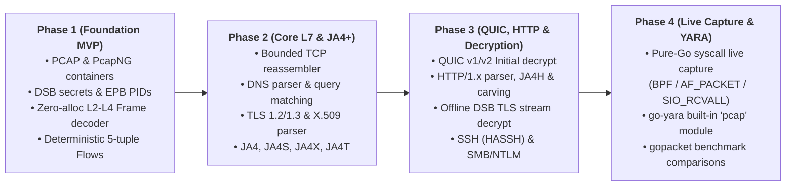

# Architecture, roadmap, and YARA integration

This document anchors the design decisions, performance invariants, protocol
expansion model, and `go-yara` `import "pcap"` specification for `go-pcap`.

## Design pillars

1. **Zero third-party dependencies (`CGO_ENABLED=0`).** All container parsing,
   protocol dissection, live socket capture (`syscall`), cryptographic key
   derivation (`crypto/hkdf`), cipher decryption (`crypto/aes`, `crypto/cipher`),
   and certificate parsing (`crypto/x509`) use only the Go standard library.
2. **Synchronous, caller-owned memory.** `New(data)` parses container headers,
   interface descriptors, Decryption Secrets Blocks (`DSB`), and block extents
   without retaining `data` or spawning background goroutines.
3. **Zero-allocation hot paths and low GC pressure.**
   - Non-capture inputs fail the 4-byte magic gate in under 5 ns with 0 heap
     allocations.
   - `DecodeFrame` uses a fixed-capacity stack array (`[MaxFrameLayers]LayerSpan`)
     and `netip.Addr` value types so L2–L4 decoding performs 0 heap allocations.
   - Payload bodies are referenced via `(Offset, Length)` byte ranges into the
     caller's slice rather than cloned upfront.
4. **Explicit work limits and anomaly flags.** Every parser enforces strict count
   and byte limits (`MaxInterfaces`, `MaxPackets`, `MaxFlows`,
   `MaxDecryptionSecrets`, `MaxFrameLayers`) and reports structural anomalies
   (such as truncated blocks, snaplen mismatches, IP header length conflicts, or
   overlapping TCP segments) without panicking.

## Phased roadmap



### Phase 1: Container, DSB, L2–L4 frame cursor, and flow summary (Implemented)

- Classic PCAP (little/big-endian, microsecond/nanosecond) and PcapNG (`SHB`,
  `IDB`, `EPB`, `SPB`, `DSB`) container parser (`New`, `NewWithLength`, `Open`).
- PcapNG `DSB` secret extraction (`SecretsTypeTLSKeyLog`,
  `SecretsTypeWireGuardKeyLog`) and `EPB` process attribution (`ProcessID`,
  `ThreadID`, packet flags).
- Zero-allocation L2–L4 frame decoder (`DecodeFrame`) supporting Ethernet,
  nested 802.1Q/802.1ad VLANs, Linux SLL/SLL2, BSD Loopback/Null, Raw IP, IPv4,
  IPv6 (with bounded extension-header traversal), TCP (including raw SYN options),
  UDP, and ICMPv4/ICMPv6.
- Deterministic 5-tuple flow aggregator (`Capture.Flows`).

### Phase 2: Bounded TCP stream reassembly, DNS, TLS 1.2/1.3, and JA4+ (Implemented)

- Synchronous, bounded TCP interval reassembler (`ReassembleTCP`,
  `Capture.Streams`) with explicit sequence-gap, midstream-pickup, and
  overlap-conflict anomaly reporting (`StreamAnomalies`).
- Standalone and capture-level DNS message parser (`ParseDNS`, `Capture.DNS`)
  with query lookup (`Capture.HasDNSQuery`).
- Standalone and capture-level TLS 1.2/1.3 handshake parser (`ParseTLSRecords`,
  `ParseTLSClientHello`, `ParseTLSServerHello`, `Capture.TLS`,
  `Capture.HasTLSJA4`, `Capture.HasTLSSNI`) extracting `ClientHello`,
  `ServerHello`, X.509 certificates, and deterministic **JA4, JA4S, JA4X, and
  JA4T** fingerprints (`JA4T`, `Frame.JA4T`, `JA4XFromDER`, `JA4XFromCert`).

### Phase 3: QUIC Initial decryption, HTTP carving, DSB stream decryption, and SSH (Implemented)

- QUIC v1 (RFC 9001) and v2 (RFC 9369) Initial packet decryption
  (`ParseQUICInitialPacket`, `DecryptQUICInitial`, `Capture.QUIC`,
  `Capture.HasQUICJA4`, `Capture.HasQUICSNI`) using `crypto/hkdf` and
  `crypto/aes`, `CRYPTO` frame reassembly, and inner TLS 1.3 `ClientHello` +
  `q13...` JA4 extraction.
- HTTP/1.x request/response dissector (`ParseHTTPRequest`, `ParseHTTPResponse`,
  `Capture.HTTP`) with **JA4H** fingerprinting and `Content-Length` / `chunked`
  body payload carving (ready to pass carved payloads directly to `go-pe` or
  `go-yara`).
- Offline TLS 1.3 application stream decryption (`ParseTLSKeyLog`,
  `Capture.TLSKeyLog`, `DecryptTLS13Records`, `Capture.DecryptedTLSStreams`)
  using embedded PcapNG `DSB` secrets or caller-supplied `SSLKEYLOGFILE`
  material, automatically feeding `Capture.HTTP`.
- SSH handshake dissector (`ParseSSHHandshake`, `Capture.SSH`) extracting version
  banners, `SSH_MSG_KEXINIT` algorithm lists, and **HASSH / HASSHServer**
  fingerprints.

### Phase 4: ReaderAt, PcapNG writer, SMB2/NTLM, beacon analytics, and stdlib live capture (Implemented)

- Bounded `io.ReaderAt` APIs (`NewFromReaderAt`, `Capture.PacketsFromReaderAt`,
  `Capture.PacketPayloadFromReaderAt`) for inspecting large captures without
  loading full files into memory.
- PcapNG streaming writer (`NewPCAPNGWriter`, `PCAPNGWriter.WriteDecryptionSecrets`,
  `PCAPNGWriter.WritePacket`) emitting spec-compliant `SHB`, `IDB`, `DSB`, and
  process-tagged `EPB` blocks.
- Pure-Go live capture (`OpenLive`, `ParseBPFBuffer`) using OS-native descriptors
  in `syscall` (`/dev/bpf*` on macOS, `AF_PACKET` on Linux) with optional kernel
  BPF bytecode filters (`BPFInstruction`).
- SMB2/3 and NTLMSSP dissector (`ParseSMB2Message`, `ParseNTLMSSP`,
  `Capture.SMB`) and statistical C2 beacon/jitter analyzer (`ComputeBeaconStats`,
  `Capture.Beacons`).
- Ready for downstream `go-yara` `import "pcap"` built-in module wiring.

## Protocol expansion model

To add a new L2/L3 encapsulation protocol:

1. Add the `LinkType`, `EtherType`, or `IPProto` constant in `types.go`.
2. Extend `DecodeFrame` in `frame.go` to append a `LayerSpan` to `Frame.Layers`
   and advance the cursor offset with explicit bounds checks.
3. Add unit tests (`frame_test.go`), bounds tests (`frame_bounds_test.go`), and
   seed corpora (`fuzz_test.go`).

To add a new L7 protocol dissector (`<proto>`):

1. Create `proto_<proto>.go` exposing both a standalone `Parse<Proto>(payload []byte)`
   function and a capture-level `(c *Capture) <Proto>(data []byte)` method.
2. Pair it with `proto_<proto>_test.go`, `proto_<proto>_bounds_test.go`,
   `proto_<proto>_fuzz_test.go`, and `proto_<proto>_benchmark_test.go`.

## `go-yara` `import "pcap"` specification

`go-pcap` remains independent of `go-yara`. In `go-yara`, the `pcap` module
adapter wraps `go-pcap` with per-scan lazy caching on `MatchContext.moduleCache`,
mirroring `modules_pe.go`.

### Top-level fields and constants

| Object | Fields |
| --- | --- |
| `pcap` | `is_pcap`, `is_pcapng`, `format`, `link_type`, `snaplen`, `packet_count`, `flow_count`, `interface_count`, `secret_count`, `declared_extent`, `input_truncated`, `anomalies` |
| `pcap.interfaces[i]` | `id`, `link_type`, `snaplen`, `name`, `description`, `os` |
| `pcap.secrets[i]` | `type`, `length`, `offset` |
| `pcap.flows[i]` | `protocol`, `src_ip`, `dst_ip`, `src_port`, `dst_port`, `packet_count`, `client_packets`, `server_packets`, `client_bytes`, `server_bytes`, `first_timestamp_ns`, `last_timestamp_ns`, `tcp_flags`, `process_id`, `anomalies`, `ja4t` |
| `pcap.dns[i]` | `flow_index`, `transaction_id`, `is_response`, `opcode`, `rcode`, `qname`, `qtype`, `answers` |
| `pcap.tls[i]` | `flow_index`, `version`, `sni`, `alpn`, `ja4`, `ja4s`, `ja4x`, `issuer`, `subject`, `not_before`, `not_after`, `serial`, `anomalies` |
| `pcap.quic[i]` | `flow_index`, `version`, `dcid`, `scid`, `sni`, `alpn`, `ja4`, `anomalies` |
| `pcap.http[i]` | `flow_index`, `method`, `host`, `uri`, `user_agent`, `status_code`, `content_type`, `body_offset`, `body_length`, `ja4h` |

### Query functions (Zero-array-allocation fast paths)

Rules often test whether any flow or transaction matches a signature without
iterating the full YARA object tree. The adapter provides overloaded functions
that scan `go-pcap` records directly:

- `pcap.has_flow(ip_string, port_int)` / `pcap.has_flow(ip_string)`
- `pcap.dns_query(exact_string)` / `pcap.dns_query(/regex/)`
- `pcap.tls_sni(exact_string)` / `pcap.tls_sni(/regex/)`
- `pcap.tls_ja4(hash_string)` / `pcap.tls_ja4s(hash_string)` / `pcap.tls_ja4x(hash_string)`
- `pcap.quic_ja4(hash_string)` / `pcap.quic_sni(exact_string_or_regex)`
- `pcap.http_uri(exact_string_or_regex)` / `pcap.http_host(exact_string_or_regex)` / `pcap.http_ja4h(hash_string)`

### Example YARA rules

```yara
import "pcap"

rule Suspicious_C2_Capture {
    condition:
        pcap.is_pcap and
        not pcap.input_truncated and
        (
            pcap.tls_ja4("t13d1516h2_8daaf6152771_b186095e22b6") or
            pcap.dns_query(/^[a-z0-9]{24,}\.stage\.example\.com$/i) or
            for any f in pcap.flows : (
                f.dst_port == 443 and
                f.anomalies & pcap.FLOW_ANOMALY_IP_FRAGMENT != 0
            )
        )
}
```
